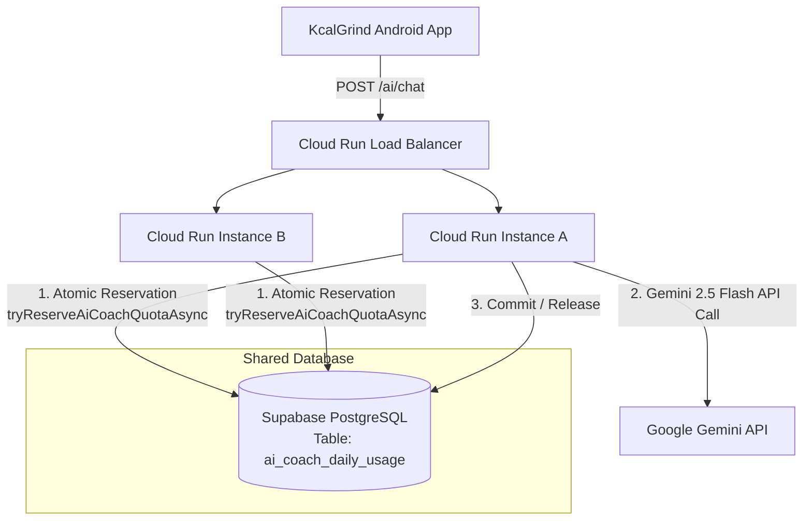

# AI Coach Shared Storage Quota & Multi-Instance Cloud Run Architecture

## 1. Context & Motivation

In previous iterations, daily quota usage and in-flight reservations for the AI Coach (Sproutling) were tracked in local process memory (`Map`) and flushed to local disk (`backend/data/ai_coach_usage.json`).

While effective for single-instance, stateful servers, this architecture breaks on Google Cloud Run because:
1. **Container Ephemerality**: Cloud Run instances scale down to zero when idle and destroy local storage.
2. **Horizontal Scaling**: Under traffic spikes, Cloud Run scales out to multiple container instances. Each instance maintains isolated in-memory state; a user could send 5 messages to Instance A and 5 messages to Instance B, bypassing the free tier daily limit (5/day).
3. **Account Deletion Compliance**: Google Play requires complete erasure of user-associated tracking data when an account is deleted. Local files on ephemeral containers cannot guarantee deterministic purge across all live or dormant instances.

---

## 2. Shared Storage Architecture

To provide strong consistency across horizontally scaled Cloud Run instances while retaining sub-millisecond local performance, KcalGrind adopts a **Supabase PostgreSQL-backed shared quota model** with graceful offline/local fallback.



---

## 3. Relational Schema: `ai_coach_daily_usage`

The table is keyed by the compound primary key `(firebase_uid, local_date)`. This ensures automatic daily reset at 12:00 AM in the user's validated IANA timezone without requiring scheduled cron jobs or database batch resets.

### PostgreSQL DDL:
```sql
CREATE TABLE IF NOT EXISTS public.ai_coach_daily_usage (
    firebase_uid TEXT NOT NULL,
    local_date TEXT NOT NULL,           -- Format: 'YYYY-MM-DD' (e.g. '2026-11-06')
    used_count INTEGER NOT NULL DEFAULT 0,
    in_flight INTEGER NOT NULL DEFAULT 0,
    timezone TEXT NOT NULL DEFAULT 'UTC',
    updated_at TIMESTAMPTZ NOT NULL DEFAULT now(),
    PRIMARY KEY (firebase_uid, local_date)
);

-- Index for rapid account deletion and audit lookups
CREATE INDEX IF NOT EXISTS idx_ai_coach_usage_uid ON public.ai_coach_daily_usage (firebase_uid);
```

### Column Semantics:
- `firebase_uid`: Authenticated Firebase UID owning the quota.
- `local_date`: User's local calendar day formatted as `YYYY-MM-DD` according to their verified timezone.
- `used_count`: Completed, successfully billed AI coach messages for this calendar date.
- `in_flight`: Actively processing AI requests. Guards against concurrent race conditions.
- `timezone`: Validated IANA timezone identifier (e.g., `America/New_York`, `Asia/Kolkata`).
- `updated_at`: Timestamp of latest modification.

---

## 4. Atomic Reservation & Lifecycle Protocol

### Step 1: Pre-Flight Atomic Reservation (`tryReserveAiCoachQuotaAsync`)
Before making an external call to Google Gemini:
1. The server resolves the user's calendar date `local_date` using the account's validated IANA timezone.
2. The server queries `ai_coach_daily_usage` for `(firebase_uid, local_date)`.
3. If `(used_count + in_flight) >= dailyLimit` (5 for Free, 50 for Pro):
   - Request is immediately rejected with HTTP `429 Too Many Requests`.
   - Payload includes user-facing explanation, `remaining: 0`, and `isPro` status.
4. If capacity remains:
   - Server increments `in_flight` by 1.
   - Client request proceeds to Google Gemini.

### Step 2A: Successful Response (`commitAiCoachQuotaAsync`)
When Gemini returns a valid reply or function call:
1. `used_count` is incremented by 1.
2. `in_flight` is decremented by 1 (clamped to 0).
3. `updated_at` is updated to `now()`.

### Step 2B: Failed Request / Timeout (`releaseAiCoachReservationAsync`)
If the Gemini API call fails (network timeout, rate limit, invalid response, 503):
1. `in_flight` is decremented by 1 (clamped to 0).
2. `used_count` remains unchanged.
3. Zero quota is consumed for failed system requests.

---

## 5. Account Deletion Purge (`DELETE /account`)

To comply with Google Play's User Data & Account Deletion policy, `DELETE /account` systematically purges the user's records across all 17 backend tables and in-memory caches:

1. `user_profiles`
2. `nutrition_goals`
3. `daily_goals`
4. `meal_logs`
5. `food_log_items`
6. `weight_entries`
7. `water_logs`
8. `ai_analysis_log`
9. `conversations`
10. `messages`
11. `saved_meals`
12. `saved_meal_items`
13. `recipes`
14. `recipe_items`
15. `custom_foods`
16. `user_subscriptions`
17. **`ai_coach_daily_usage`**

In addition to database tables, the backend clears:
- In-memory `aiCoachDailyUsage` Map
- In-memory `inFlightAiCoachReservations` Map
- In-memory `userTimezones` Map
- In-memory `rateLimits` Map

---

## 6. Offline & Local Development Fallback

When `SUPABASE_URL` or `SUPABASE_SERVICE_KEY` are unset (such as in local development, offline mode, or isolated unit tests), the system automatically and gracefully falls back to local memory and atomic disk persistence (`backend/data/ai_coach_usage.json`). Zero crashes occur if Supabase is unavailable.
