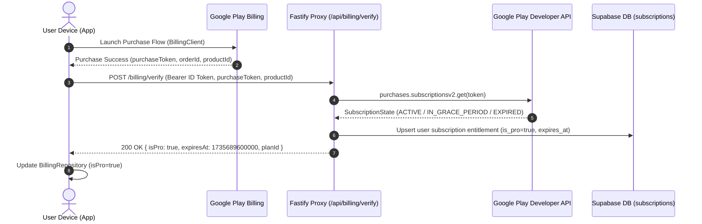

# Google Play Billing Setup & Verification Architecture

## 1. Google Play Console Configuration Steps

### 1.1 In-App Subscription Product IDs
Configure two base subscription products in Google Play Console under **Monetize** -> **Products** -> **Subscriptions**:

| Plan | Product ID | Base Plan ID | Billing Period | Target Price | Free Trial |
| :--- | :--- | :--- | :--- | :--- | :--- |
| **Kcal Grind Pro Monthly** | `kcalgrind_pro_monthly` | `p1m` | 1 Month | `[SET_MONTHLY_PRICE]` | 7 days |
| **Kcal Grind Pro Annual** | `kcalgrind_pro_annual` | `p1y` | 1 Year | `[SET_ANNUAL_PRICE]` | 7 days |

#### Configuration Details:
1. **Name:** Kcal Grind Pro Monthly / Annual
2. **Benefits list:**
   - 50 Gemini 2.5 Flash AI Coach messages per day
   - Unlimited AI meal photo scanning & nutrition decomposition
   - Natural language voice and text quick-logging
   - Full 90-day macro and weight trend analytics
   - Indian & International curated macro-verified recipes
   - PDF diary export and unlimited cloud backup
3. **Offer Structure:**
   - Base plan with auto-renewing billing.
   - Introductory offer: 7-day free trial for new subscribers.
   - Grace period: 16 days (enabled in Play Console).
   - Account hold: 30 days (enabled).

---

## 2. Testing Tracks & License Testers

### 2.1 License Testing (Instant Test Transactions)
1. Go to **Play Console** -> **Settings** -> **License testing**.
2. Add developer and QA Google email accounts to the **License testers** list.
3. Under **License response**, select:
   - `RESPOND_NORMALLY` for regular testing (test card charged simulated 0 currency).
   - Test renewals expire in 5 minutes (monthly) / 15 minutes (annual) instead of standard calendar periods.

### 2.2 Internal Testing Track
1. Build signed release bundle:
   `./gradlew bundleRelease`
2. Upload `.aab` to **Testing** -> **Internal testing**.
3. Create an internal testers email list and distribute the opt-in URL.
4. Testers must accept the opt-in invite using their device's Google Play account.

---

## 3. Server-Side Purchase Verification Design

Google Play guidelines require server-to-server verification for auto-renewing subscriptions to prevent client-side credential spoofing.



### 3.1 Verification Endpoint
- **Route:** `POST /billing/verify`
- **Auth:** Firebase Auth ID Token (Bearer)
- **Request Body:**
  ```json
  {
    "productId": "kcalgrind_pro_annual",
    "purchaseToken": "inapp_purchase_token_from_google_play",
    "packageName": "com.kcalgrindai.app"
  }
  ```
- **Backend Verification Logic (Google Play Developer API):**
  Uses Google API Client with Service Account credentials (`androidpublisher.googleapis.com`):
  `androidpublisher.purchases.subscriptionsv2.get({ packageName, token })`
  Evaluates `subscriptionState`:
  - `SUBSCRIPTION_STATE_ACTIVE`: Grants Pro entitlement.
  - `SUBSCRIPTION_STATE_IN_GRACE_PERIOD`: Keeps Pro entitlement with advisory banner.
  - `SUBSCRIPTION_STATE_CANCELED` (within paid period): Pro valid until `lineItems[0].expiryTime`.
  - `SUBSCRIPTION_STATE_EXPIRED` / `REVOKED`: Revokes Pro entitlement.

### 3.2 Supabase Entitlement Storage Schema
```sql
CREATE TABLE user_subscriptions (
    user_id UUID PRIMARY KEY REFERENCES auth.users(id) ON DELETE CASCADE,
    product_id TEXT NOT NULL,
    purchase_token TEXT NOT NULL,
    order_id TEXT,
    is_pro BOOLEAN NOT NULL DEFAULT FALSE,
    subscription_state TEXT NOT NULL, -- ACTIVE, GRACE_PERIOD, EXPIRED
    expires_at TIMESTAMPTZ NOT NULL,
    auto_renewing BOOLEAN NOT NULL DEFAULT TRUE,
    created_at TIMESTAMPTZ DEFAULT NOW(),
    updated_at TIMESTAMPTZ DEFAULT NOW()
);
CREATE INDEX idx_user_subscriptions_is_pro ON user_subscriptions(user_id, is_pro);
```

### 3.3 Real-Time Developer Notifications (RTDN via Google Cloud Pub/Sub)
- Webhook route: `POST /billing/webhook/play-rtdn`
- Listens for Pub/Sub messages:
  - `SUBSCRIPTION_RENEWED` -> Extends `expires_at`.
  - `SUBSCRIPTION_CANCELED` -> Flags auto-renewing false.
  - `SUBSCRIPTION_EXPIRED` -> Sets `is_pro = false`.
  - `SUBSCRIPTION_REVOKED` -> Revokes Pro immediately.

### 3.4 How App Reads Entitlement
1. **Local Room/Cache first:** Fast startup without waiting for network.
2. **Token Refresh Sync:** On launch / login, app queries `GET /billing/entitlement` returning latest verified subscription state.
3. **BillingClient Fallback:** If offline or reinstalled, `BillingClient.queryPurchasesAsync()` recovers tokens from the local Play Store cache and synchronizes them once reconnected.

---

## 4. Play Console Readiness Checklist (What is needed from you)
Before replacing the mock `BillingRepositoryImpl` with live Google Play Billing code, please confirm:
- [ ] Google Play Console account created and Merchant Account linked.
- [ ] Subscriptions `kcalgrind_pro_monthly` and `kcalgrind_pro_annual` created and set to **Active**.
- [ ] Google Cloud Service Account created with "Google Play Developer" role and `service_account.json` downloaded for backend verification.
- [ ] Play Console -> API access -> Service account granted "View financial data, orders, and cancellation survey responses" and "Manage orders and subscriptions".
- [ ] At least one `.aab` release uploaded to the Internal Testing track.
- [ ] QA / tester emails registered in **License testing**.
