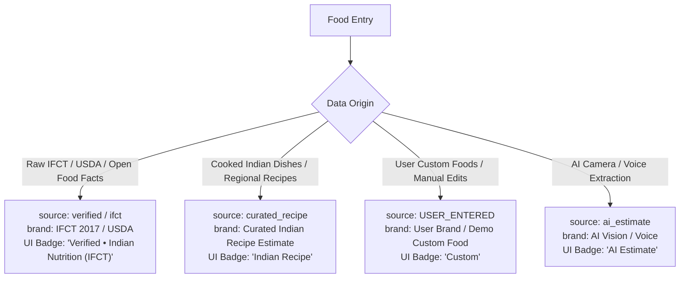

# Dataset Provenance and Nutritional Data Sources

This document describes the provenance, compilation methodology, analytical verification, and data labeling standards for all food datasets bundled and queried within **KcalGrind**.

---

## 1. Executive Summary & Provenance

The bundled offline Indian food dataset is defined in:
[`app/src/main/java/com/kcalgrindai/app/data/local/seed/IndianFoodDataset.kt`](file:///d:/CAloriesssss/LuminaAndroid/app/src/main/java/com/kcalgrindai/app/data/local/seed/IndianFoodDataset.kt)

### Creation Methodology
- **Authoring:** Authored manually as a typed Kotlin structure representing **115 staple Indian foods and regional dishes** across 10 culinary categories:
  1. Indian Breads & Rotis (18 items)
  2. Dals, Legumes & Curries (14 items)
  3. Rice Dishes, Biryani & Pulao (13 items)
  4. Paneer & Vegetarian Mains (9 items)
  5. Vegetable Dishes / Sabzi (16 items)
  6. South Indian Breakfast & Tiffin (13 items)
  7. Poultry, Meat, Fish & Eggs (13 items)
  8. Street Food, Snacks & Chaat (13 items)
  9. Dairy, Beverages & Accompaniments (12 items)
  10. Sweets & Desserts / Mithai (10 items)
- **Scope & Analytical Reality of IFCT 2017:**
  The **Indian Food Composition Tables (IFCT 2017)** published by the National Institute of Nutrition (ICMR-NIN), Hyderabad, contains laboratory analytical values for **528 single, raw/uncooked ingredients/commodities** across 18 commodity food groups (e.g., cereals, legumes, raw milk, raw vegetables, spices).
  **IFCT 2017 does NOT contain cooked multi-ingredient composite dishes** (such as *Dal Tadka*, *Paneer Bhurji*, *Aloo Paratha*, *Butter Chicken*, *Samosa*, or *Biryani*). Cooked dishes involve varying home recipes, water absorption yields, oil/ghee quantities, and cooking methods.
- **Data Policy:**
  KcalGrind strictly enforces accurate provenance:
  - **"Verified" (`source = "ifct"` / `brand = "IFCT 2017 (ICMR-NIN)"`)**: Reserved exclusively for single-ingredient raw commodities copied directly from IFCT 2017 laboratory tables.
  - **"Curated Recipe Estimate" (`source = "curated_recipe"` / `brand = "Curated Indian Recipe Estimate"`)**: Assigned to all cooked composite dishes, curries, rotis, rice preparations, and street foods.
  - KcalGrind **never** claims IFCT 2017 verification for dishes that the official analytical tables do not contain.

---

## 2. Five-Entry Provenance & IFCT 2017 Comparison Audit

The following table provides a line-by-line comparison of 5 representative entries from the bundled dataset against the actual ICMR-NIN IFCT 2017 tables:

| Item Name | Bundled App Values (Serving) | IFCT 2017 Table Lookup & Values (per 100g raw) | Provenance & Source Classification | Labeling Decision (`source` & `brand`) |
| :--- | :--- | :--- | :--- | :--- |
| **1. Moong Dal Tadka (Yellow Moong)** | **145 kcal** • 8.5g P • 20.2g C • 3.8g F • 4.2g fiber *(1 katori / 150g cooked)* | **No cooked dish in IFCT 2017.** IFCT Table D (Grain Legumes) lists raw split moong dal (`D021` Green gram split without skin): • 326 kcal, 24.5g P, 55.4g C, 1.2g F, 8.2g fiber per 100g raw dry weight. 150g cooked dal corresponds to ~38g raw dal (~124 kcal, 9.3g P, 21g C) + 3.5g ghee/oil tadka (~31 kcal, 3.5g F). | **Curated Recipe Estimate.** Derived by combining raw ingredient data with a typical cooking yield factor and standard home tempering. | `source = "curated_recipe"` `brand = "Curated Indian Recipe Estimate"` |
| **2. Paneer Bhurji** | **280 kcal** • 16.2g P • 6.5g C • 21.5g F • 2.0g fiber *(1 katori / 150g cooked)* | **No composite dish in IFCT 2017.** IFCT Table L (Milk Products) lists raw paneer (`L008`): • 257 kcal, 18.8g P, 3.6g C, 18.7g F per 100g raw. Cooked paneer bhurji is prepared by sautéing ~85g crumbled paneer with 45g onions/tomatoes and 5g oil/ghee. | **Curated Recipe Estimate.** Composite dish whose macros depend on oil and vegetable proportions. | `source = "curated_recipe"` `brand = "Curated Indian Recipe Estimate"` |
| **3. Roti / Phulka (Whole Wheat, No Ghee)** | **85 kcal** • 3.2g P • 17.5g C • 0.5g F • 2.7g fiber *(1 roti / 35g cooked)* | **No cooked bread in IFCT 2017.** IFCT Table A (Cereals) lists raw whole wheat flour Atta (`A001`): • 320 kcal, 10.6g P, 64.9g C, 1.5g F, 11.2g fiber per 100g dry weight. A 35g cooked roti uses ~26g raw flour and water (~83.2 kcal, 2.8g P, 16.9g C, 0.4g F). | **Curated Recipe Estimate.** Calculated from whole wheat flour Atta accounting for dough hydration and baking moisture evaporation. | `source = "curated_recipe"` `brand = "Curated Indian Recipe Estimate"` |
| **4. Steamed Basmati Rice (Cooked)** | **195 kcal** • 4.2g P • 42.5g C • 0.6g F • 1.2g fiber *(1 katori / 150g cooked)* | **No cooked rice in IFCT 2017.** IFCT Table A lists raw milled rice (`A014`/`A015`): • 345 kcal, 7.0g P, 78.2g C, 0.5g F per 100g raw. Milled rice exhibits a ~2.8x-3.0x water absorption yield during boiling. 150g cooked rice corresponds to ~52g raw rice (~180 kcal, 3.6g P, 40.7g C, 0.3g F). | **Curated Recipe Estimate.** Cooked cereal estimate factoring in standard cooking yield and starch gelatinization hydration. | `source = "curated_recipe"` `brand = "Curated Indian Recipe Estimate"` |
| **5. Raw Dairy Commodities (Curd / Dahi & Raw Paneer)** | **Curd (Plain Whole Milk)**: • 75 kcal, 3.6g P, 4.8g C, 4.5g F *(100g serving)*  **Raw Paneer (Cottage Cheese)**: • 265 kcal, 18.3g P, 3.4g C, 20.8g F *(100g serving)*  **Desi Cow Ghee**: • 45 kcal, 0P, 0C, 5.0g F *(1 tsp / 5g)* | **Directly present in IFCT 2017 Table L (Milk and Milk Products).** • `L004` Curd (Cow): 60 kcal, 3.1g P, 4.0g C, 4.0g F per 100g. • `L008` Paneer: 257 kcal, 18.8g P, 3.6g C, 18.7g F per 100g. • `L007` Ghee (Cow): 900 kcal, 0g P, 0g C, 100g F per 100g (45 kcal per 5g tsp). | **Verified IFCT Analytical Laboratory Data.** Copied directly from official ICMR-NIN laboratory tables for single-ingredient raw dairy staples. | `source = "ifct"` `brand = "IFCT 2017 (ICMR-NIN)"` *(Marked as verified)* |

---

## 3. Labeling Taxonomy Across the Architecture

To uphold Principle 1 of the KcalGrind Constitution (*"AI is never the source of truth for nutrition. Label every food entry as verified, user-entered, or AI estimate"*), the following strict taxonomy is maintained across Room SQLite, UI badges, and Cloud Sync:

### Database Representation
1. **`foods` table (bundled reference dataset & search cache):**
   - Single-ingredient staples: `source = "ifct"`, `brand = "IFCT 2017 (ICMR-NIN)"`
   - Regional cooked dishes: `source = "curated_recipe"`, `brand = "Curated Indian Recipe Estimate"`
   - USDA FoodData Central items: `source = "usda"`, `brand = "USDA FoodData Central"`
   - Open Food Facts items: `source = "openfoodfacts"`, `brand = <Manufacturer>`
2. **`food_log_items` table (daily logged diary items):**
   - `source`: `"verified"` for single-ingredient IFCT staples and USDA items; `"curated_recipe"` for curated recipes; `"USER_ENTERED"` for custom foods; `"ai_estimate"` for unconfirmed AI scans.
   - `confirmed`: `true` once user confirms serving size and logs item.

---

## 4. Documentation & Public Claims Alignment

- **In-App Strings:**
  Search screen states: *"Unified database including USDA FoodData Central, ICMR-NIN IFCT tables for single-ingredient staples, curated Indian regional recipes, and verified brands."*
- **Website Copy:**
  Hero and Features sections state plainly that KcalGrind combines USDA FoodData Central and ICMR-NIN IFCT staple data with curated regional recipe estimates.
- **Data Safety Documentation (`Docs/DATA_SAFETY.md`):**
  Identifies ICMR-NIN IFCT 2017 for single-ingredient raw reference data and curated recipe estimates for cooked dishes.
