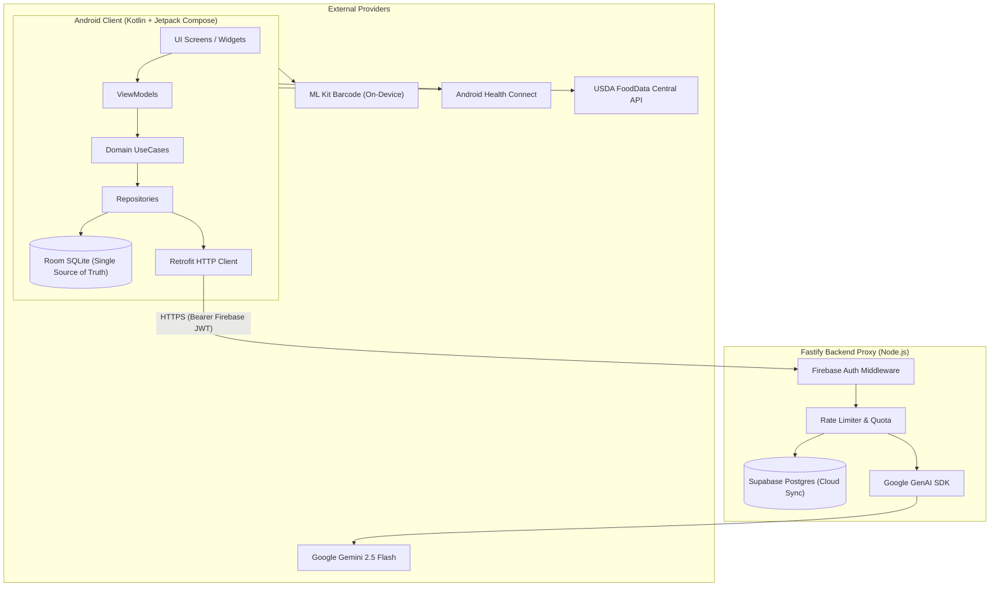

# KcalGrind

> High-performance, offline-first Android calorie and macronutrient tracker powered by on-device intelligence and a secure Gemini 2.5 Flash backend proxy.

**Status:** Pre-launch (solo-maintained). Play Store release and Cloud Run deployment pending.

---

## Core Philosophy: Nutrition Integrity First

> [!IMPORTANT]
> **AI is never the source of truth for nutrition.**
> In KcalGrind, AI models provide convenience and fast estimation, but every food entry carries an explicit `source` tag:
> - **Verified Databases:** USDA FoodData Central, ICMR-NIN (Indian food composition), Open Food Facts.
> - **User-Entered:** Custom foods and manual recipe entries authored by the user.
> - **AI Estimates:** Multimodal estimates generated by Google Gemini 2.5 Flash, accompanied by an item-level confidence score ($0.0$ to $1.0$).
>
> An architectural confirmation step sits between AI prediction and database persistence—no AI candidate can be written into the local diary without user review and confirmation.

---

## Implemented Features

- **Multimodal AI Food Logging:** Log meals from camera photos, natural language voice recordings, or unstructured free text processed via a secure backend proxy to Google Gemini 2.5 Flash.
- **On-Device Barcode Scanning:** Instant UPC/EAN barcode scanning using Google ML Kit (runs 100% on-device, fully offline) with fallback to Open Food Facts API.
- **Nutrition Databases:** Search across verified nutrition databases including USDA FoodData Central and Open Food Facts with offline search indexing.
- **Offline-First Food Diary:** Daily calorie and macro tracking powered by a local Room SQLite database with reactive Jetpack Compose UI streams.
- **Custom Foods & Saved Meals:** Create, edit, and delete custom food items with macro validation, or save recurring meal sets for one-tap re-logging.
- **AI Nutrition Coach:** Conversational nutrition assistance with function-calling tools that query user profile targets and daily logs without hallucinating diary state.
- **Health Connect Integration:** Reads daily step counts and active calories burned from Android Health Connect; optional deduction from net calories with explicit activity multiplier safeguards.
- **Water & Weight Tracking:** Daily hydration logging (glasses/ml) and body weight timeline with weekly moving averages.
- **Local Smart Reminders:** Inexact meal and water reminders scheduled via Android WorkManager that adapt to meal windows and avoid repeat alerts on the same day.
- **Firebase Authentication & Guest Mode:** Sign in with Google, email/password, or use fully offline Anonymous Guest mode.
- **Account Deletion & Data Purge:** Complete in-app and remote cloud account purge adhering to Google Play compliance (cascades all relational records and wipes local Room SQLite).

---

## Architecture Overview

KcalGrind follows Clean Architecture and MVVM patterns with strict separation of concerns:

```
Android Client (Kotlin + Jetpack Compose)
│
├── UI Layer (Stateless Composables + Material3 "Vitality Flow" theme)
├── Presentation (ViewModels with StateFlow UiState)
├── Domain Layer (Pure Kotlin UseCases, Models, Repository Interfaces)
└── Data Layer (Room SQLite local single source of truth + Retrofit)
        │
        │ HTTPS (Bearer Firebase JWT)
        ▼
Node.js Fastify Backend Proxy
│
├── Auth Middleware (Firebase Admin Token Verification)
├── In-Memory Rate Limiter & AI Coach Quota Guard
└── Google GenAI SDK (gemini-2.5-flash)
```

### System Flow Diagram



### Security Principle: Zero Client Keys
No AI provider keys (Google Gemini API keys) are ever embedded in the Android APK. All AI inference is proxied through the Fastify backend, which validates the user's Firebase authentication token and enforces daily quota limits.

---

## Repository Structure

```
.
├── app/                  # Android application module (Kotlin, Jetpack Compose, Hilt, Room)
├── backend/              # Node.js Fastify backend proxy for Gemini 2.5 Flash & Supabase sync
├── Docs/                 # In-depth architectural, deployment, and security specifications
├── gradle/               # Gradle wrapper and version catalogs (libs.versions.toml)
├── .github/              # GitHub Actions CI workflows and issue templates
└── LICENSE               # Apache License 2.0
```

---

## Getting Started & Local Setup

### Prerequisites

1. **Android Development:**
   - Android Studio (Ladybug 2024.2+ or newer)
   - JDK 17 (configured as Gradle JDK)
   - Android SDK Platform 35 and Build-Tools installed
2. **Backend Development:**
   - Node.js 20.x or 22.x LTS
   - npm 10+
3. **Firebase Account:**
   - A Firebase project with **Authentication** enabled (Email/Password, Google Sign-In, and Anonymous).

---

### Step 1: Backend Setup

1. Navigate to the `backend/` directory:
   ```bash
   cd backend
   npm install
   ```

2. Configure environment variables:
   ```bash
   cp .env.example .env
   ```
   Open `.env` and fill in:
   - `GEMINI_API_KEY`: Your Google Gemini API key from [Google AI Studio](https://aistudio.google.com/).
   - `FIREBASE_PROJECT_ID`: Your Firebase project ID (e.g., `kcal-grind-ai`).
   - `SUPABASE_URL` & `SUPABASE_SERVICE_KEY`: (Optional for local testing; required for cloud sync).

3. Start the backend proxy in development mode:
   ```bash
   npm run dev
   ```
   The backend will listen on `http://0.0.0.0:8000`. On the standard Android emulator, access this via `http://10.0.2.2:8000`.

---

### Step 2: Android App Setup

1. **Firebase Configuration:**
   - In your Firebase Console, register an Android application with package name `com.kcalgrindai.app`.
   - Download `google-services.json` and place it in the `app/` folder:
     ```bash
     app/google-services.json
     ```
   *(Note: `app/google-services.json` is gitignored to protect project credentials).*

2. **Local Properties Configuration:**
   Create a `local.properties` file in the repository root if it does not already exist:
   ```properties
   sdk.dir=/path/to/your/Android/sdk
   USDA_API_KEY=DEMO_KEY
   BACKEND_URL=http://10.0.2.2:8000/
   ```

3. **Build the Debug APK:**
   ```bash
   # Windows PowerShell
   .\gradlew assembleDebug

   # macOS / Linux
   ./gradlew assembleDebug
   ```

---

### Step 3: Running Tests

#### Run Android Unit Tests
The Android test suite uses JUnit 4, Robolectric, and Turbine across 53 test classes:
```bash
./gradlew testDebugUnitTest
```

#### Run Backend Integration Tests
Execute the standalone unit and lifecycle test suites using Node's native test runner:
```bash
cd backend
node --test test-account-deletion.js test-gemini-client-unit.js test-ai-coach-quota.js test-auth-middleware.js test-gemini-structure.js
```

---

## Screenshots

<!-- TODO: Add actual device screenshots prior to public store release -->
| Dashboard & Macro Arcs | AI Meal Scanner | Living Sproutling |
| :---: | :---: | :---: |
| *TODO: Add screenshot `docs/screenshots/dashboard.png`* | *TODO: Add screenshot `docs/screenshots/scanner.png`* | *TODO: Add screenshot `docs/screenshots/coach.png`* |

---

## Roadmap

The following components are architecturally specified in `Docs/` and planned for rollout:

- [ ] **Google Play Billing:** In-app subscription handling (`Docs/BILLING_SETUP.md`) replacing the local mock repository.
- [ ] **Recipe Builder (Phase G):** Custom multi-ingredient recipe creation with yield and portion auto-calculation.
- [ ] **Cloud Run Production Deployment:** Automated deployment of the Fastify container to Google Cloud Run with Secret Manager mounting (`Docs/05_DEPLOYMENT_CLOUD_RUN.md`).
- [ ] **Google Play Store Release:** Production submission on the Google Play Console (`Docs/LAUNCH_READINESS.md`).

---

## Documentation & Governance

- [Architecture & Layering Rules](Docs/01_ARCHITECTURE.md)
- [Technology Stack Rationale](Docs/02_TECH_STACK.md)
- [AI Proxy & Prompt Design](Docs/04_AI_INTEGRATION.md)
- [Cloud Run Deployment Guide](Docs/05_DEPLOYMENT_CLOUD_RUN.md)
- [Data Safety Declaration](Docs/DATA_SAFETY.md)
- [Security Policy](SECURITY.md)
- [Contributing Guidelines](CONTRIBUTING.md)
- [License](LICENSE)

---

## License

This project is licensed under the Apache License 2.0. See [LICENSE](LICENSE) for details.
